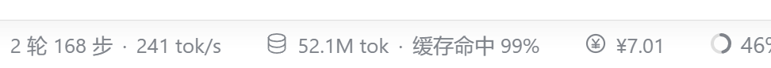
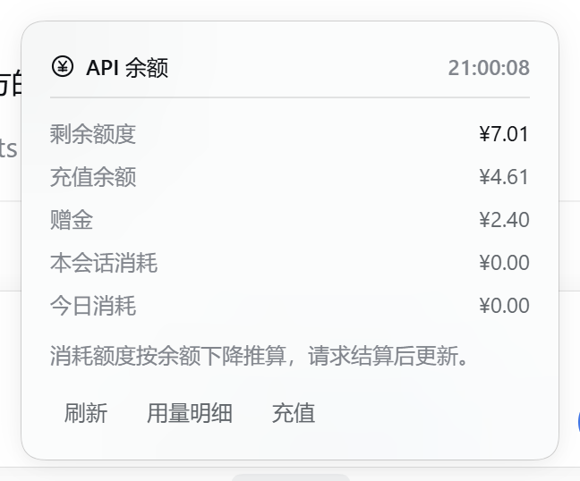

# @breey05/dsh-balance-widget

在 DeepSeek Harness 输入框下显示当前模型供应商的余额。切换模型供应商时，余额入口立即切换并重新读取对应接口。

## 支持的供应商

| 模型供应商 ID | 余额来源 | 凭据 |
|---|---|---|
| `aigocode` | `https://api.aigocode.dev/v1/usage` 的 `balance`，USD | 本地 `AIGOCODE_API_KEY` |
| `taffy` | `https://taffy.work/v1/usage` 的 remaining / quota.remaining / balance，USD | 本地 `TAFFY_API_KEY` |
| `tafy` | 同上（旧 ID，保留兼容） | 本地 `TAFFY_API_KEY` |
| `ds` | 同上，但使用该路由自己的密钥 | 本地 `DS_API_KEY` |
| `deepseek-account` | DSH 账号 Remote 的充值与赠金钱包 | 设置中的 DeepSeek 登录 |

上表就是 `llm-pi-ai` 的 provider ID。多个 ID 可能指向同一钱包但配置不同密钥（例如 `taffy`、`tafy`、`ds` 都走 `taffy.work`），插件按 ID 各自读取，因此改 ID 后余额不会静默变空。不在表中的供应商显示“余额不可用”。DeepSeek API Key 路由（`https://api.deepseek.com/anthropic`）当前尚未接入余额接口。不同模型如果属于同一供应商，使用同一钱包。

新增供应商时，在 `index.js` 的 `SOURCES` 和 `client.js` 的 `PROVIDERS` 中各加一行；`npm test` 会校验两边 ID 一致。

## 安装与更新

在 DSH 的插件安装框输入：

```
@breey05/dsh-balance-widget@1.2.0
```

也可使用 GitHub 仓库地址 `git+https://github.com/BREEY05/dsh-balance-widget.git`，或安装本地目录。需要 DSH `>=0.2.1-rc.2 <0.3.0`。安装后刷新当前页面。

在本机 DSH 凭据管理中配置 API Key，切勿将密钥粘贴到聊天或提交到仓库。无需为账号路由配置 API Key。

## 行为与限制

- 使用会话的 `modelSelection` projection 订阅模型选择；空白会话使用 Host 模型目录提供的默认供应商。
- 每个供应商、每个会话分别保存消费记录，切换后不会把不同钱包的差额记作消费。切换期间迟到的请求不会污染新供应商数据。
- 点余额入口查看余额、观察到的会话消耗、今日消耗和刷新按钮。
- 余额来自供应商结算快照，并非逐 token 实时计费。消耗按观察到的余额下降估算；同账号其他设备的使用也可能计入，切换后首次读取仅建立基线。
- 每五分钟轮询，聊天节点变化后延迟读取，普通读取最少间隔 45 秒；失败后退避 2–15 分钟。切换供应商立即启动新读取，手动刷新可主动读取。
- 消耗计数保存在浏览器 localStorage/sessionStorage，不包含密钥。卸载后可通过清除站点数据移除。多个标签页同时观察同一钱包可能重复计数，跨标签页同时写入也可能竞争；这些记录仅作估算，账单以供应商为准。
- Host 通过受保护路由请求两家中转服务；API Key 留在 Host。无遥测，无外部脚本，无运行时依赖。
- 本插件在 DSH Host 进程内运行；只安装你信任的插件。

原账号版截图（当前版本额外显示供应商名称）：




## 开发与发布

`npm test` 检查路由选择、账户钱包合计、未知供应商、消费隔离和迟到请求。测试使用模拟响应，不代表真实供应商连通性。

`client.js` 注册 `conversation.composer.dock`；`index.js` 按 `SOURCES` 为每个供应商注册一条受保护路由（`/api/aigocode-usage`、`/api/taffy-usage`、`/api/tafy-usage`、`/api/ds-usage`）。保留原始图标及中英文本地化。

社区市场收录通过向 [awesome-dsh-plugin](https://github.com/awesome-dsh-plugin/awesome-dsh-plugin/blob/main/contributing.md) 提交目录 PR；npm 发布本身不会自动完成首次收录。后续版本由市场定期探测。

MIT License. 仓库：https://github.com/BREEY05/dsh-balance-widget
