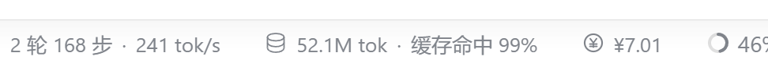
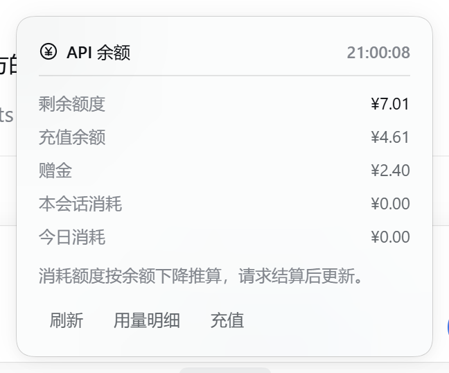

# @breey05/dsh-balance-widget

> Package name: `@breey05/dsh-balance-widget`. The unscoped npm name `dsh-balance-widget`
> already belongs to a different plugin, so this package uses a scope to avoid a
> profile-level package-name collision.

A small live money meter for **DeepSeek Harness (DSH)**: under the composer, next to the
built-in turn/token statistics, it shows the signed-in DeepSeek account's remaining balance
and how much the current conversation has spent.

```
◉ ¥7.48 · -¥0.04
```

Click the pill for a details popover: available balance, recharge and bonus wallets, this
conversation's spend, today's spend, the last refresh time, and links to the Platform usage
and top-up pages.





## Features

- **Real account balance**, read through DSH's existing account Remote — no API key in the
  browser, nothing typed in by hand.
- **Per-conversation and per-day spend** inferred from the balance drops you actually see.
- **Conservative polling**: reads on mount, shortly after a reply settles, on focus, on a
  five-minute idle timer, and on demand. Failures back off for minutes so the account
  features that share the endpoint keep working.
- Follows the UI language (English / 中文), light and dark themes, and only uses host theme
  tokens.
- No build step, no runtime dependencies, no telemetry.

## Usage

1. Sign in under **Settings → Account** (the widget reads the account's wallets).
2. Open or start a conversation. The pill appears under the composer, beside the built-in
   turn/token statistics: it shows the available balance, plus this conversation's spend once a
   request has settled.
3. Click the pill for the wallet breakdown, this-conversation and today's spend, the Platform
   usage/top-up links, and **刷新 / Refresh** to read again on demand.
4. Spend figures appear after the Platform settles a request (usually within a minute); the
   pill highlights when it observes a drop, and an available balance below ¥5 is shown in
   amber.

## Install

### From npm (recommended when the public registry is reachable)

1. In DSH, open **插件 / Plugins → 添加插件 / Add plugin**.
2. Paste the package name, optionally pinned to a version:

   ```
   @breey05/dsh-balance-widget@1.0.0
   ```

   `@breey05/dsh-balance-widget` alone installs the latest published version.
3. Confirm and wait for the install to finish; the bundle is selected and enabled
   automatically. Reload the Harness window once if the pill does not appear.

DSH asks the public npm registry first and falls back to the npmmirror registry when it is
unreachable, so this is the most reliable channel on networks where GitHub is blocked.

The same spec can be passed to the agent tool:

```
plugin_manager install_bundle target="@breey05/dsh-balance-widget@1.0.0"
```

### From a Git repository

1. In DSH, open **插件 / Plugins → 添加插件 / Add plugin** (or the arrow →
   **安装第三方插件 / Install a third-party plugin**).
2. Paste the repository address:

   ```
   git+https://github.com/BREEY05/dsh-balance-widget.git
   ```

   Pin a release if you like: `git+https://github.com/BREEY05/dsh-balance-widget.git#v1.0.0`.
3. Confirm and wait for the install to finish; the bundle is selected and enabled
   automatically.
4. If the pill does not appear, reload the Harness window once.

The same spec can be passed to the agent tool:

```
plugin_manager install_bundle target="git+https://github.com/BREEY05/dsh-balance-widget.git#v1.0.0"
```

### From a local directory

Clone or download this repository, then install the **absolute path** of its root through the
same dialog (or `plugin_manager install_bundle` with the path).

### Requirements

- DSH `>=0.2.1-rc.2 <0.3.0` (declared in `engines.dsh`).
- A **signed-in DeepSeek account** (Settings → Account). The widget reads account wallets, so
  an API-key-only installation shows `未登录 · 余额` and points at the account settings.
- The model route must be the account route (`deepseek-account`) for its spending to appear in
  that wallet.

## How the numbers are produced

| Figure | Source |
|---|---|
| Remaining balance | `ctx.remote.account.getBalance(...)` → the Host's `deepseekAccount.getBalance()`. The pill shows the spendable total per currency (recharge wallet + bonus credit, the same total the Platform spends from); the popover breaks out both wallets. Nothing is estimated. |
| This conversation's spend | The sum of observed **total-balance drops** while the conversation is open, whichever wallet paid. When a top-up or bonus raises the balance, the rise is ignored and the baseline moves up. |
| Today's spend | The same drops accumulated per local calendar day in `localStorage` (`dsh.api-balance.today.v1`). |
| Per-conversation memory | The per-conversation figure is kept in `sessionStorage` (`dsh.api-balance.sessions.v1`), so reloading the tab keeps the label honest. |

Balance reads happen on mount, after a chat node settles (+30 s and +90 s, at least 45 s apart),
when the tab becomes visible or focused, on a 5-minute idle timer, and when you click
**Refresh**. A direct high-frequency probe of the Platform summary endpoint returned HTTP 429,
so the widget spaces reads and backs off for 2–15 minutes after a failure. Failures never show
a fake `¥0`; the last settled figure stays visible with a warning tone.

Trade-off: the figure is a **settled snapshot**, not per-token realtime. Platform billing can
lag the request that caused it, so a spend figure appears when a later read observes the drop.

## Privacy

- Reads only the signed-in account's wallet balances through the host's authenticated account
  Remote; credentials never enter the browser.
- No telemetry, no analytics, no third-party requests of its own.
- Persists only the spend counters in `localStorage` / `sessionStorage`; uninstalling the plugin
  leaves them behind (clear site data to remove them).

## Known limitations

- Spend is balance-delta, not per-token pricing: usage on the same account from another device
  or the Platform web chat also appears as a drop.
- Only account wallets are supported; the API-key `/user/balance` endpoint would need a Host
  route in a future version.
- Tunables (read cadence, burst delays, backoff, low-balance threshold) are constants in
  `client.js`, because a client-side plugin has no Host→Client configuration channel.
- The usage/top-up actions are ordinary links; the account settings page keeps its own
  embedded Platform view.
- DSH plugin APIs are prerelease: the widget uses the `remote.account` namespace, the
  `conversation.composer.dock` slot and its standard props, and `window.__DSH_BOOT__`. A later
  DSH version may change them; `engines.dsh` makes such an install fail loudly instead.
- Installation runs the bundle's Host half in-process outside the workspace sandbox. This
  bundle's Host half is empty, but only install plugins you trust.

## Uninstall

**插件 / Plugins → Installed plugins → @breey05/dsh-balance-widget → Remove**, or:

```
plugin_manager remove_bundle target="@breey05/dsh-balance-widget"
```

## Troubleshooting

- **The install cannot reach GitHub.** The installer checks the repository with `git ls-remote`
  and fetches it with pnpm, so it follows your Git and npm network configuration. If the GitHub
  website loads but Git fails with `Recv failure: Connection was reset`, configure Git's proxy
  (`git config --global http.proxy <proxy-url>`) or install from an npm-published copy, where
  DSH can fall back to the npmmirror registry.
- **No pill after install.** Reload the Harness window once.
- **`未登录 · 余额`.** Sign in under **Settings → Account**; an API-key-only installation has no
  account wallet to read.
- **The number does not change.** The Platform settles billing with a delay; the widget reads
  shortly after a reply settles and backs off after failures. Press **Refresh** in the popover to
  read again.

## Repository layout

| File | Role |
|---|---|
| `package.json` | Bundle manifest: `dsh.bundle.patch` plus the `dsh.client` browser half. |
| `cordis.patch.yml` | Inserts the `api-balance-widget` Loader entry. |
| `index.js` | Host half: intentionally empty; all work happens in the browser. |
| `client.js` | Browser half: account Remote reads, spend ledger, dock registration, view. |
| `locale/en.json`, `locale/zh.json` | Plugin Manager title and description. Runtime strings live in `client.js`. |
| `icon.svg` | Original coin artwork. |

Maintainer notes (creating the repository, releases, optional npm publishing) are in
[PUBLISHING.md](PUBLISHING.md).

## License

[MIT](LICENSE).

