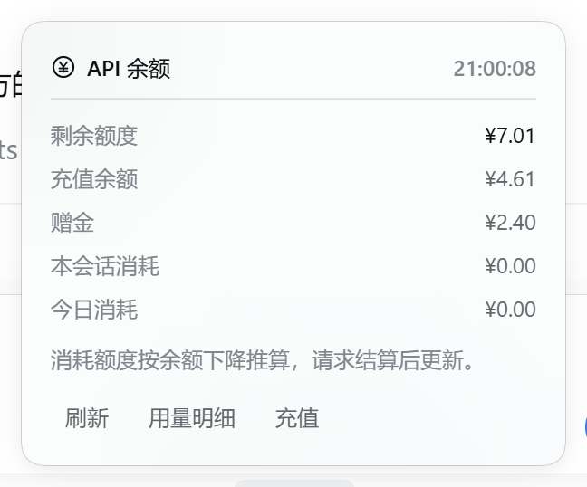

# @breey05/dsh-balance-widget

在 DeepSeek Harness 输入框下显示当前模型供应商的余额。切换模型供应商时，余额入口立即切换并重新读取对应接口。

## 供应商自动识别

无需预先登记供应商 ID。插件会读取 DSH profile 中该供应商的 `baseURL` 和 `apiKeyEnv`，并使用对应凭据自动探测余额接口。成功发现的接口会按来源缓存，后续读取时复用。

探测会依次尝试以下常见余额路径：

`/user/balance`、`/v1/usage`、`/v1/credits`、`/v1/dashboard/billing/subscription`、`/api/user/self`、`/v1/balance`、`/api/usage`、`/usage`

接口需支持使用该供应商的 API Key 进行 Bearer 认证，并返回插件能够识别的数值余额。凭据优先读取 profile 声明的 `apiKeyEnv`；若未声明，则按供应商 ID 推导环境变量名，例如 `my-provider` 对应 `MY_PROVIDER_API_KEY`。

少数常见供应商有内置快捷配置，用于指定专属接口或凭据名；这不是固定的支持名单。只要 profile 提供 `baseURL` 和可用凭据，其他供应商也会走自动发现流程。仅能通过网页登录态查看、或不符合上述接口和认证方式的服务，无法自动读取。

## 接入一个新供应商

不要靠猜，也不要向用户索要接口细节。在仓库里跑一次探测脚本，它会自己问出协议、模型清单和余额地址：

```
node scripts/probe-provider.mjs --id <provider-id> --base https://<base-url> --key-env <ENV_NAME>
```

脚本按环境变量、再按 `~/.dsh/.credentials.yaml` 的顺序取 Key，依次试 `/v1/models`、`/v1/chat/completions`、`/v1/responses`、`/v1/messages` 判断是 OpenAI 兼容还是 Anthropic 兼容协议，并探测余额接口。

## 安装与更新

在 DSH 的插件安装框输入：

```
@breey05/dsh-balance-widget@1.4.5
```

也可使用 GitHub 仓库地址 `git+https://github.com/BREEY05/dsh-balance-widget.git`，或安装本地目录。需要 DSH `>=0.2.1-rc.2 <0.3.0`。安装后刷新当前页面。

在本机 DSH 凭据管理中配置 API Key，切勿将密钥粘贴到聊天或提交到仓库。无需为账号路由配置 API Key。

## 行为与限制

- 使用会话的 `modelSelection` projection 订阅模型选择；空白会话使用 Host 模型目录提供的默认供应商。
- 每个���应商、每个会话分别保存消费记录，切换后不会把不同钱包的差额记作消费。切换期间迟到的请求不会污染新供应商数据。
- 点余额入口查看余额、本对话消耗、今日消耗、本对话 token 与请求数，以及刷新按钮。
- 本对话消耗优先取供应商返回的计费总额（如 sourcesdata 的 `usage.total.actual_cost`）：Host 记录进入该对话时的累计值，之后只把增量算给这段对话，因为充值、赠金失效或价格变化不应被误算成消耗。
- 供应商不返回计费字段时，消耗回退为观察到的余额下降估算；同账号其他设备的使用可能被计入，切换后首次读取仅建立基线。
- 本对话 token 数直接累加会话日志里每次模型调用上报的 `usage`（含缓存命中/写入与推理 token），按 `assistant/message` 的消息 id 去重，不需要任何价格表。
- 每五分钟轮询，聊天节点变化后延迟读取，普通读取最少间隔 45 秒；失败后退避 2–15 分钟。切换供应商立即启动新读取，手动刷新可主动读取。
- 消耗计数与每个对话的计费基线保存在浏览器 localStorage/sessionStorage，不包含密钥。卸载后可通过清除站点数据移除。多个标签页同时观察同一钱包时，共享消费信息并避免重复计数。
- Host 通过受保护路由请求供应商接口；API Key 留在 Host，浏览器只拿到余额数字。自动发现时会用同一把 Key 依次探测该供应商 `baseURL` 下的常见余额接口。
- 本插件在 DSH Host 进程内运行；只安装你信任的插件。

原账号版截图（当前版本额外显示供应商名称）：




## 开发与发布

`npm test` 棡查路由选择、账户钱包合计、未知/重命名供应商、自动发现与缓存、profile YAML 解析、消费隔离、迟到请求、计费总额解析与对话 token 累计。

`client.js` 注册 `conversation.composer.dock`；`index.js` 按 `SOURCES` 为内置供应商快捷配置各路由，并提供通用 `/api/provider-balance` 路由供未知供应商自动发现与读取。

社区市场收录通过向 [awesome-dsh-plugin](https://github.com/awesome-dsh-plugin/awesome-dsh-plugin/blob/main/contributing.md) 提交目录 PR；npm 发布本身不会自动完成首次收录。

MIT License. 仓库：https://github.com/BREEY05/dsh-balance-widget
